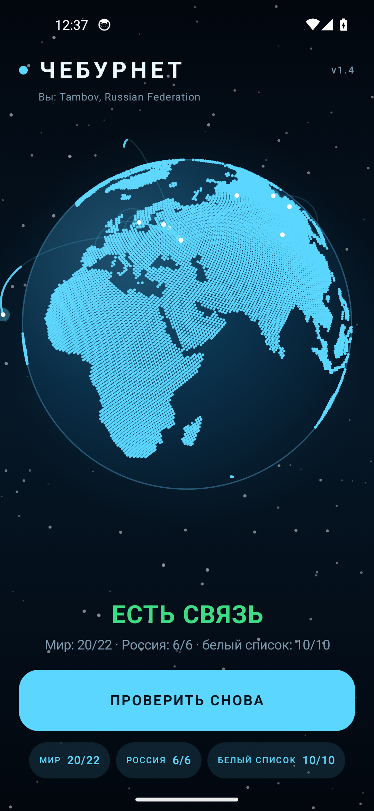
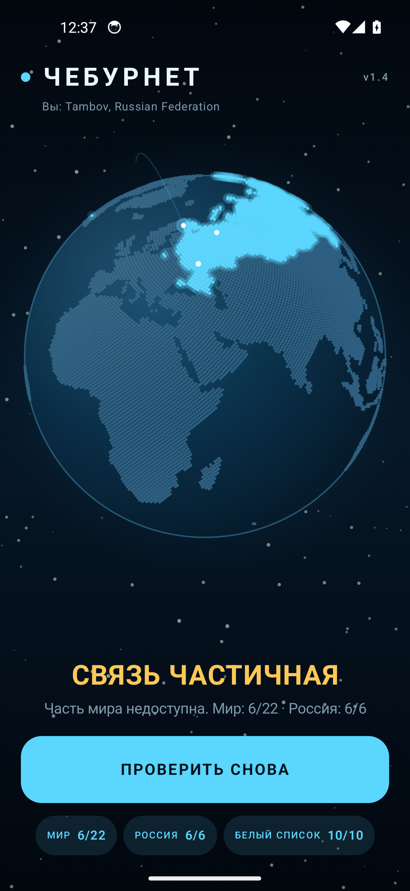
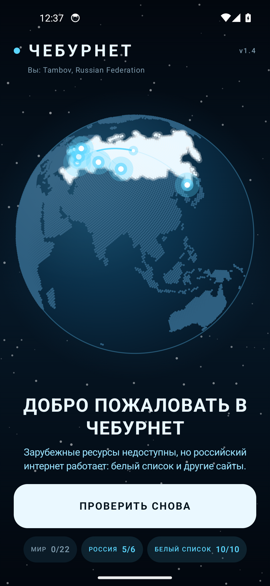
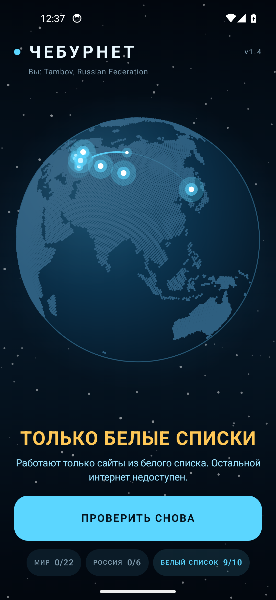
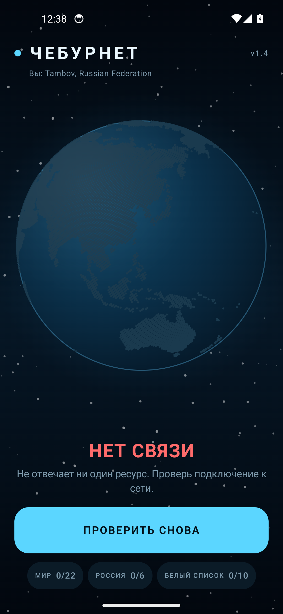
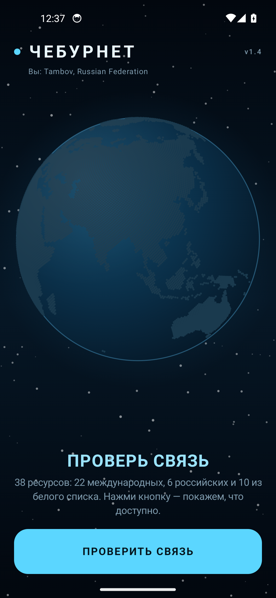

# Чебурнет

Приложение-детектор «какой у вас интернет»: один тап — проверяем 39 ресурсов
(19 зарубежных IP, 10 российских вне белого списка и 10 из белого списка)
и показываем результат на голубом вращающемся глобусе.

## Пять режимов

Проверки взвешиваются: **мир — 10 000** баллов за ресурс, **Россия вне БС — 100**,
**белый список — 1**. Пороги заданы в процентах и не зависят от размера списков.

| Режим | Условие |
| --- | --- |
| **НЕТ СВЯЗИ** | Мир = 0, РФ = 0, БС = 0 (S = 0) |
| **ЕСТЬ СВЯЗЬ** | Мир > 60% |
| **СВЯЗЬ ЧАСТИЧНАЯ** | Мир > 0 и ≤ 60% |
| **ДОБРО ПОЖАЛОВАТЬ В ЧЕБУРНЕТ** | Мир = 0, РФ > 50% |
| **ТОЛЬКО БЕЛЫЕ СПИСКИ** | Мир = 0, РФ ≤ 50%, БС > 0 |

Баллы: `S = 10 000 × Мир + 100 × РФ + 1 × БС`. Сумма показывается в окне
«Результаты проверки».

## Как это выглядит

- Голубой точечный глобус: 176 стран по реальным границам (Natural Earth), 45 000 точек.
- Глобус крутится пальцем, авто-вращение замирает под пальцем.
- **Местоположение по IP** (без GPS и разрешений): метка «вы здесь» и подпись «Вы: город».
- Проверка запускается автоматически при открытии приложения.
- От вашей точки к странам, куда прошёл пинг, летят дуги-лучи через космос
  с бегущим огоньком; в чебурне — к городам. После проверки лучи плавно гаснут
  за ~2,5 секунды.
- Страны закрашиваются волной от своего центра по мере поступления ответов.

## Скриншоты

| Есть связь | Связь частичная |
| --- | --- |
|  |  |

| Чебурнет | Только белые списки |
| --- | --- |
|  |  |

| Нет связи | До проверки |
| --- | --- |
|  |  |

## Что проверяется

**Зарубежные IP (19) — по 2–3 на континент, все отвечают на ping:**

| Континент | IP |
| --- | --- |
| Северная Америка | 8.8.8.8 (Google DNS), 1.1.1.1 (Cloudflare), 208.67.222.222 (OpenDNS) |
| Европа | 9.9.9.9 (Quad9), 149.112.112.112 (Quad9), 94.140.14.14 (AdGuard) |
| Азия | 223.5.5.5 (AliDNS), 180.76.76.76 (Baidu), 168.126.63.1 (KT) |
| Южная Америка | 200.221.11.100, 200.160.2.3 |
| Африка | 196.11.240.215, 41.86.0.1 |
| Океания | 139.130.4.5 (Telstra), 203.2.193.124 |


**Российские вне белого списка (10):** Райффайзен (raiffeisen.ru), Ситилинк (citilink.ru),
Домклик (domclick.ru), Хабр (habr.com), vc.ru, Магнит (magnit.ru), Форбс (forbes.ru),
Интерфакс (interfax.ru), Фонтанка (fontanka.ru), E1.ru (e1.ru). Банки с антибот-защитой
(РСХБ, Совкомбанк, МКБ) не используются: они режут не-браузерный TLS.
Именно они отключаются в режиме БС (подтверждено отчётами обучения по Билайну),
поэтому отличают «чебурнет» от «только белых списков».

**Белый список Минцифры (10):** Яндекс (ya.ru), VK (vk.com), Mail.ru (mail.ru),
Госуслуги (gosuslugi.ru), Ozon (ozon.ru), Wildberries (wildberries.ru),
Газпромбанк (gazprombank.ru), 2ГИС (2gis.ru), Rutube (rutube.ru), VK Видео (vkvideo.ru).

Важно: Сбербанка, Т-Банка и других крупных банков в официальном перечне нет —
из банков там только Альфа-Банк, ВТБ, ПСБ и с апреля 2026 Газпромбанк.
Поэтому в приложении стоит Альфа-Банк; МТС и 2ГИС — в перечне, а не «вне списка».

Как проверяется:
- зарубежные IP — ICMP-пинг (3 пакета, успех при любом ответе);
- российские сайты — полноценный HTTPS-запрос: DPI в БС пропускает TCP-хэндшейк,
  но рвёт TLS/HTTP, поэтому сайт считается доступным только при реальном
  HTTP-ответе.

## Режим обучения

«Режим обучения» открывается **долгим нажатием на заголовок «ЧЕБУРНЕТ»**. Она прогоняет расширенный список
(~210 хостов: текущие списки + менее популярные российские сайты, региональные провайдеры и местные СМИ) и собирает
отчёт с устройством, оператором data-SIM, типом сети, публичным IP, провайдером (ISP) и вердиктом. Кнопка
«Отправить в Telegram» открывает системное «Поделиться» — отчёт уходит боту,
по нему обновляются списки.

Список хостов для обучения тоже берётся из `lists.json` (поле `learning`),
поэтому его можно править на GitHub без пересборки. Если поля нет — используется
встроенный список.

## Обновление списков с GitHub

Списки можно менять без пересборки приложения:

1. Списки лежат в репозитории `github.com/3dbaxtep/cheburnet` (`lists.json`).
2. URL прописан в `RemoteLists.kt` (константа `URL`):
   `https://raw.githubusercontent.com/3dbaxtep/cheburnet/main/lists.json`.
3. Приложение при старте скачивает JSON, кэширует его и использует при проверке;
   если сети нет — берёт кэш, если и его нет — встроенные списки.

Формат: `international`, `ruBlocked`, `whitelist`; у каждого ресурса
`id`, `title`, `host`, `country` (ADM0_A3), `probe` (`ICMP` или `TCP`).

## Сборка

Нужны JDK 17 и Android SDK 34.

```bash
./gradlew assembleDebug
# APK: app/build/outputs/apk/debug/app-debug.apk
```

Тесты: `./gradlew testDebugUnitTest`.

## Установка

```bash
adb install -r Cheburnet-1.11-release.apk
```

Android 7.0+ (minSdk 24), разрешения только INTERNET и ACCESS_NETWORK_STATE.

## Для разработки

В debug-сборке долгое нажатие на заголовок «ЧЕБУРНЕТ» переключает
демо-сценарии: есть связь → частичная → чебурнет → только белые списки →
нет связи. В release этого нет.

## Структура

```
app/src/main/java/ru/cheburnet/
├── MainActivity.kt      точка входа
├── Model.kt             модели, вердикты, логика подсветки стран
├── Targets.kt           ресурсы (15 + 6 + 10) и города
├── Net.kt               проверка доступности (ICMP ping)
├── IpLocation.kt        местоположение по IP
├── CheckViewModel.kt    прогон проверки и состояние UI
└── ui/                  Compose: глобус, экран, тема
app/src/main/assets/countries_mask.png   карта стран (176 регионов)
app/src/main/assets/countries_map.json   id → код страны
```

## Публикация

Инструкция для Google Play и готовые ассеты — в [PUBLISH.md](PUBLISH.md).

## Лицензия

MIT
